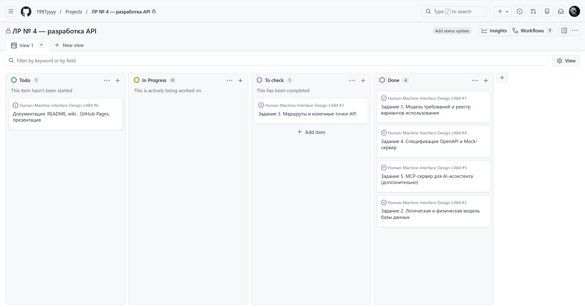

# Campus Events — документация ЛР № 4

Проект: **Campus Events**, афиша и запись на студенческие мероприятия БГУ.
Курс «Проектирование человеко-машинных интерфейсов», лабораторная работа № 4,
группа 13. Работа продолжает ЛР № 3: требования, модель данных и архитектура
взяты оттуда и уточнены под API.

## Что добавлено в этой работе

| Задание | Результат | Где смотреть |
|---|---|---|
| 1. Модель требований | 16 историй, 20 вариантов использования, реестр «актор → история → UC» | [Функциональные требования](02-requirements.md) |
| 2. Модель данных | 14 таблиц, 13 перечислений, триггеры инвариантов, DDL и `.sql` | [Схема базы данных](05-database.md) |
| 3. Маршруты и точки | 14 ресурсов, 28 строк соответствия UC → HTTP | [API проекта](06-api.md) |
| 4. OpenAPI и Mock | спецификация на 29 операций, 28 схем, примеры запросов, протокол Mock-сервера 8 из 8 | [API проекта](06-api.md) |
| Презентация | 12 слайдов: распределение работ, требования, модель данных, API, работа с репозиторием | [Презентация проекта](07-presentation.md) |
| 5. MCP-сервер | 3 инструмента, 2 ресурса, 1 шаблон промпта, mock-база SQLite | [MCP-сервер](08-mcp.md) |

## Ключевые решения

**Одна модель — три артефакта.** Физическая схема, словарь полей и ER-диаграмма
собираются из одного описания `tools/gen_db.py`. Расхождение между документом и
DDL невозможно по построению: они не пишутся руками.

**Счётчик мест ведёт база.** `session.taken` меняется только триггером регистрации,
поэтому правило `0 ≤ taken ≤ capacity` нельзя нарушить ни одним запросом, включая
`UPDATE` из консоли. Приложение не пересчитывает места — оно читает их.

**Коды ошибок отделены от текста.** В теле ошибки всегда есть машинный `code`:
клиент по нему выбирает реакцию, текст показывает пользователю. Это позволяет
менять формулировки, не ломая приложение.

**MCP не дублирует API, а объясняет его.** Инструменты MCP повторяют три действия
из API, но с проверками бизнес-правил и структурированными ошибками; ресурсы
отдают только те данные, которые нужны ассистенту для ответа.

## Навигация

- [Функциональные требования и реестр вариантов использования](02-requirements.md)
- [Диаграмма файлов приложения](03-files.md)
- [Дополнительная спецификация](04-spec.md)
- [Схема базы данных и словарь полей](05-database.md)
- [API: маршруты, конечные точки, коды ошибок](06-api.md)
- [MCP-сервер: инструменты, ресурсы, проверка в Inspector](08-mcp.md)
- [Презентация проекта](07-presentation.md)
- Репозиторий: `README.md`, спецификация: `api/openapi.yaml`

## Доска проекта

Работа ведётся в GitHub Projects: четыре колонки, одна задача — один issue,
в каждой задаче записан критерий приёмки. На снимке: задания 1, 2, 4 и 5 в
колонке *Done*, задание 3 ждёт проверки, задача документации — в *To do*.

