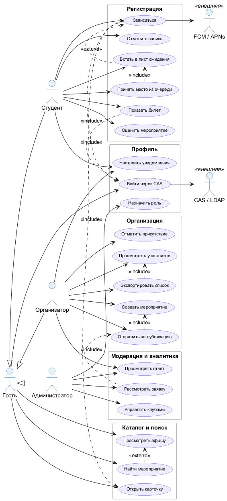

# Задание 1. Модель требований и реестр вариантов использования

Модель унаследована из ЛР № 3 (12 пользовательских историй, 20 вариантов использования,
4 действующих лица) и дополнена до полного покрытия функциональности API.
Формат — как на рис. 1 задания: одна строка реестра на один вариант использования,
слева направо прослеживается цепочка **Действующее лицо → User Story → Use Case**.

На диаграмме — те же 20 вариантов, что в реестре §3: пять блоков по предметным
областям (регистрация, профиль, организация, модерация и аналитика, каталог),
связи `include` — обязательные шаги, `extend` — необязательные расширения.
Внешние системы (CAS/LDAP и FCM/APNs) показаны как вторичные действующие лица.

## 1. Что дополнено относительно ЛР № 3

Анализ показал два разрыва, оба закрыты в этой работе.

**Разрыв 1: пять вариантов использования не имели пользовательской истории.**
UC-14 (участники), UC-15 (экспорт), UC-20 (отчёт), UC-21 (вход через CAS) и UC-23
(назначение роли) существовали на диаграмме, но не были выведены ни из одной истории —
то есть висели в модели без обоснования. Добавлены US-13…US-16.

**Разрыв 2: четыре варианта использования не имели конечной точки в API.**
Управление клубами (UC-19), отчёт по мероприятию (UC-20), настройка уведомлений
(UC-22) и назначение роли (UC-23) не покрывались ни одним методом из перечня ЛР № 3.
Добавлены шесть методов: `POST /clubs`, `PATCH /clubs/{id}`,
`GET /events/{id}/report`, `GET /notifications/settings`,
`PUT /notifications/settings`, `PATCH /users/{id}/role`.
Итог: 29 методов вместо 23.

> Арифметическая неточность ЛР № 3: в тексте указано «22 метода», при перечислении
> перечислено 23. Состав не менялся, в этой работе он уточнён до 29.

## 2. Новые пользовательские истории

| Код | История | Приоритет | Критерий приёмки |
|---|---|---|---|
| US-13 | Как организатор, я хочу видеть список участников сессии и выгружать его, чтобы вести учёт на месте | High | Список с поиском и фильтром по статусу; экспорт CSV/XLSX с ФИО, группой, статусом и временем отметки |
| US-14 | Как организатор, я хочу сводку по мероприятию, чтобы понимать, сколько записалось и сколько пришло | Medium | Сводка: записалось, пришло, доля пришедших, отмены, длина очереди; период — от публикации до суток после последней сессии |
| US-15 | Как пользователь, я хочу входить через корпоративный CAS, чтобы не заводить отдельный пароль | High | Вход только через CAS/LDAP; при первом входе создаётся учётка, роль — «Студент»; пароль не хранится |
| US-16 | Как администратор, я хочу назначать роли, чтобы права выдавались осознанно и были видны в журнале | High | Роль из четырёх значений; изменение попадает в журнал аудита; отозвать последнего администратора нельзя |

## 3. Реестр вариантов использования

| № | Действующее лицо | User Story | Use Case |
|---|---|---|---|
| 1 | Гость | US-01 Просмотр афиши и поиск мероприятия | UC-01 Просмотреть афишу |
| 2 | Гость | US-01 Просмотр афиши и поиск мероприятия | UC-02 Найти мероприятие (extend UC-01) |
| 3 | Гость | US-01 Просмотр афиши и поиск мероприятия | UC-04 Открыть карточку |
| 4 | Студент | US-02 Запись на мероприятие в два действия | UC-05 Записаться (include UC-04, UC-21) |
| 5 | Студент | US-03 Отмена записи | UC-06 Отменить запись |
| 6 | Студент | US-04 Лист ожидания с автоматическим продвижением | UC-07 Встать в лист ожидания (extend UC-05) |
| 7 | Студент | US-04 Лист ожидания с автоматическим продвижением | UC-08 Принять место из очереди (include UC-07) |
| 8 | Студент | US-05 Билет с QR-кодом, доступный без сети | UC-09 Показать билет (include UC-21) |
| 9 | Студент | US-10 Оценить мероприятие после посещения | UC-10 Оценить мероприятие |
| 10 | Организатор | US-06 Создание и публикация мероприятия | UC-11 Создать мероприятие |
| 11 | Организатор | US-06 Создание и публикация мероприятия | UC-12 Отправить на публикацию (include UC-11) |
| 12 | Организатор | US-07 Отметка присутствия сканированием QR | UC-13 Отметить присутствие |
| 13 | Организатор | US-13 Просмотр участников и выгрузка | UC-14 Просмотреть участников |
| 14 | Организатор | US-13 Просмотр участников и выгрузка | UC-15 Экспортировать список (include UC-14) |
| 15 | Администратор | US-08 Модерация заявки на публикацию | UC-17 Рассмотреть заявку (include UC-12) |
| 16 | Администратор | US-12 Администратор управляет клубами | UC-19 Управлять клубами |
| 17 | Организатор, Администратор | US-14 Сводка по мероприятию | UC-20 Просмотреть отчёт |
| 18 | Гость, Студент, Организатор, Администратор | US-15 Вход через CAS | UC-21 Войти через CAS |
| 19 | Студент, Организатор | US-09 Напоминание о мероприятии; US-11 Настроить каналы уведомлений | UC-22 Настроить уведомления |
| 20 | Администратор | US-16 Назначение ролей и журнал аудита | UC-23 Назначить роль |

## 4. Текстовые сценарии

Развёрнуто описаны четыре сценария, в которых больше всего ветвлений: запись,
лист ожидания, отметка присутствия и модерация. Остальные сведены в таблицу
в конце раздела — для них достаточно основного потока и одной-двух ветвей.

### UC-05 Записаться на мероприятие

**Актор:** студент. **Предусловие:** вход выполнен через CAS, сессия существует.

1. Студент открывает карточку мероприятия, интерфейс запрашивает `GET /events/{id}`
   и показывает сессии со свободными местами.
2. Нажимает «Записаться» — `POST /sessions/{sid}/registrations` с телом `{"source": "Приложение"}`.
3. API проверяет, что `taken < capacity`, и что у пользователя нет активной записи
   на эту сессию (частичный уникальный индекс).
4. Создаются регистрация и билет, триггер увеличивает `session.taken`.
5. Ответ `201`: `status: Записан`, `qr_payload` для офлайн-показа.

**Альтернативы и исключения:**

- мест нет → `409 NO_SEATS`, интерфейс предлагает лист ожидания (UC-07);
- уже записан → `409 ALREADY_REGISTERED`, показывается существующий билет;
- сессия уже началась → `422 SESSION_IN_PAST`.

**Постусловие:** место занято, билет доступен без сети.

### UC-07 / UC-08 Лист ожидания и получение места

**Актор:** студент. **Предусловие:** мест нет.

1. Студент встаёт в очередь — `POST /sessions/{sid}/waitlist`; присваивается `waitlist_position`.
2. При отмене чужой записи триггер освобождает место и создаёт `seat_offer`
   со сроком действия 30 минут.
3. Студент получает предложение и подтверждает его —
   `POST /seat-offers/{id}/accept`.
4. API проверяет срок: предложение превращается в регистрацию, `seat_offer` закрывается.

**Исключения:** срок истёк → `409 OFFER_EXPIRED`, место уходит следующему;
студент отказался — то же поведение.

### UC-13 Отметить присутствие

**Актор:** организатор. **Предусловие:** мероприятие опубликовано, студент пришёл.

1. Организатор сканирует QR-код билета; приложение читает `qr_payload`.
2. Отправляется `POST /checkins/batch` с `Idempotency-Key` (или `POST /tickets/{id}/check-in`).
3. API находит билет, проверяет, что он не отозван, и записывает `used_at`.
4. Ответ `200` с ФИО и временем отметки.

**Исключения:** билет уже отмечен → `200` с `alreadyMarked: true` (повторное
сканирование не считается ошибкой); билет отозван → `409 TICKET_USED`;
`qr_payload` не найден → `404 NOT_FOUND`.

**Постусловие:** `used_at` заполнен один раз, время повторной отметки не перезаписывается.

### UC-17 Рассмотреть заявку на модерацию

**Актор:** администратор. **Предусловие:** организатор отправил мероприятие
на публикацию (UC-12), заявка в статусе «На рассмотрении».

1. Администратор открывает очередь — `GET /moderation/requests?status=На рассмотрении`.
2. Изучает версию мероприятия: `GET /events/{id}/versions`.
3. Принимает решение — `POST /moderation/requests/{id}/decision` с типом
   «Утвердить» или «Вернуть».
4. При утверждении мероприятие получает `status: Опубликовано`; при возврате
   организатору уходит уведомление с комментарием.

**Исключения:** возврат без комментария или комментарий короче 10 символов →
`422 VALIDATION_FAILED` с `field: comment`; повторное решение →
`409 ALREADY_MODERATED`; заявка чужой организации → `403 NOT_OWNER`.

**Постусловие:** решение неизменяемо, запись остаётся в журнале.

### Остальные сценарии

| UC | Основной поток | Исключения |
|---|---|---|
| UC-01 Просмотреть афишу | `GET /events` с фильтрами и страницами; карточки с датой, клубом, свободными местами | пустая выдача → `200` с `items: []`, подсказка снять фильтры |
| UC-02 Найти мероприятие | `GET /search?q=` — поиск по названию и описанию | ничего не найдено → `200` с пустым списком и предложением соседних категорий |
| UC-04 Открыть карточку | `GET /events/{id}` — описание, сессии, отзывы | скрыто модератором → `404 NOT_FOUND` |
| UC-06 Отменить запись | `DELETE /registrations/{id}`; место возвращается, билет гасится | билет уже отмечен → `409 TICKET_USED`; чужая запись → `403 FORBIDDEN` |
| UC-09 Показать билет | `GET /tickets` / `GET /tickets/{id}`; QR рисуется из `qr_payload` локально | билет отозван → `409 TICKET_USED` |
| UC-10 Оценить мероприятие | `POST /reviews` с оценкой и текстом, только после посещения | мероприятие не посещено → `422 VALIDATION_FAILED`; повторная оценка → `409` |
| UC-11 Создать мероприятие | `POST /events` → черновик с сессиями и вместимостью | название короче 3 символов → `422 TITLE_TOO_SHORT`; сессия в прошлом → `422 SESSION_IN_PAST` |
| UC-12 Отправить на публикацию | `POST /events/{id}/submit`; создаётся версия и заявка | нет сессий → `422`; уже на рассмотрении → `409` |
| UC-14 Просмотреть участников | `GET /sessions/{sid}/participants` с поиском и фильтром по статусу | чужая сессия → `403 NOT_OWNER` |
| UC-15 Экспортировать список | `GET /sessions/{sid}/export` → CSV/XLSX | пустой список → `200` с файлом-заголовком |
| UC-19 Управлять клубами | `POST /clubs`, `PATCH /clubs/{id}` | дубль названия → `409`; нет роли администратора → `403 ROLE_REQUIRED` |
| UC-20 Просмотреть отчёт | `GET /events/{id}/report` — записалось, пришло, доля, отмены, очередь | нет прав → `403 NOT_OWNER` |
| UC-21 Войти через CAS | `POST /auth/cas/callback` обменивает тикет, выдаёт JWT; `GET /me` отдаёт профиль | тикет недействителен → `401 UNAUTHENTICATED`; истёк JWT → `401 TOKEN_EXPIRED` |
| UC-22 Настроить уведомления | `GET`/`PUT /notifications/settings` — каналы и напоминания | неизвестный канал → `422 VALIDATION_FAILED` |
| UC-23 Назначить роль | `PATCH /users/{id}/role`; изменение попадает в журнал | отзыв последнего администратора → `409`; нет прав → `403 ROLE_REQUIRED` |

## 5. Проверка покрытия

| Проверка | Результат |
|---|---|
| Вариантов использования в модели | 20 |
| Из них выведены из пользовательской истории | 20 из 20 |
| Пользовательских историй | 16 (12 из ЛР № 3 + 4 новых) |
| Историй без варианта использования | 0 |
| Действующих лиц | 4 (гость, студент, организатор, администратор) |
| Вариантов использования без конечной точки API | 0 из 20 |
| Методов в спецификации API | 29 |

**О нумерации.** Коды UC взяты из диаграммы ЛР № 3 без изменений, поэтому в
последовательности есть пропуски: UC-03, UC-16, UC-18 были объединены с соседними
при укрупнении блоков. Коды не перенумерованы сознательно: на них ссылаются
текстовые сценарии и диаграммы ЛР № 3, и перенумерация сломала бы эти ссылки.

**Прослеживаемость дальше.** Каждый UC из таблицы 3 имеет строку в таблице
«Use Case → HTTP-метод» файла `docs/06-api.md`, а каждый метод — операцию в
`api/openapi.yaml`. Таким образом цепочка «история → вариант использования →
метод → операция в спецификации» замкнута и проверяема.
