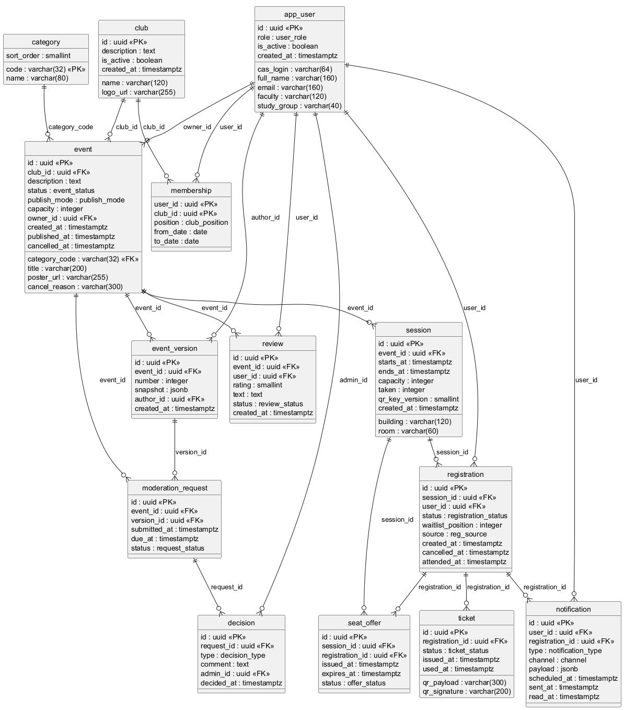

# Схема базы данных: логическая и физическая модели

Модель унаследована из ЛР № 3 (ER-диаграмма, 14 таблиц) и уточнена под физическую реализацию: добавлены перечисления, ограничения целостности и составные уникальные индексы. Первичные ключи — UUID, время — `timestamptz` в UTC. Значения перечислений совпадают с подписями интерфейса, чтобы не держать два словаря.

Всего таблиц: **14**, полей: **103**, перечислений: **13**.
Состав модели и полный текст DDL в читаемом виде — [db/index.html](../db/index.html).

## Логическая модель

Логическая схема — сущности, их ключи и связи, без привязки к типам СУБД
(рис. 2 задания). Связи «один ко многим» читаются сверху вниз: одна запись
в левой колонке соответствует многим в правой.

| № | Сущность | Первичный ключ | Внешние ключи | Связи |
|---|---|---|---|---|
| 1 | `club` | `id` | — | 1:N с `event`, `membership` |
| 2 | `category` | `code` | — | 1:N с `event` |
| 3 | `app_user` | `id` | — | 1:N с `membership`, `registration`, `review`, `notification`; владелец `event`, автор `event_version`, администратор `decision` |
| 4 | `event` | `id` | `club_id`, `category_code`, `owner_id` | 1:N с `session`, `event_version`, `moderation_request`, `review` |
| 5 | `event_version` | `id` | `event_id`, `author_id` | 1:N с `moderation_request` (модератор видит снимок) |
| 6 | `session` | `id` | `event_id` | 1:N с `registration`, `seat_offer` |
| 7 | `membership` | (`user_id`, `club_id`) | `user_id`, `club_id` | M:N между пользователем и клубом, с ролью в клубе |
| 8 | `registration` | `id` | `session_id`, `user_id` | 1:1 с `ticket`; 1:N с `seat_offer` |
| 9 | `ticket` | `id` | `registration_id` | 1:1 с `registration`, создаётся вместе с ней |
| 10 | `seat_offer` | `id` | `session_id`, `registration_id` | предложение места из очереди, живёт 30 минут |
| 11 | `moderation_request` | `id` | `event_id`, `version_id` | 1:1 с `decision` |
| 12 | `decision` | `id` | `request_id` (уникальный), `admin_id` | 1:1 с `moderation_request`, неизменяемо |
| 13 | `review` | `id` | `event_id`, `user_id` | одна оценка на пару «мероприятие — студент» |
| 14 | `notification` | `id` | `user_id`, `registration_id` (nullable) | журнал отправленных уведомлений |

Правила, которые логическая модель задаёт до всякой СУБД:

- место на сессии — не поле «сколько осталось», а вычисляемое `capacity − taken`;
- активная запись на сессию у пользователя одна (частичный уникальный индекс);
- решение по заявке существует в единственном экземпляре и не переписывается;
- оценка ставится только по посещённому мероприятию.

## Физическая модель

Физическая модель — та же схема с типами PostgreSQL, перечислениями,
индексами и триггерами (рис. 3 задания). DDL — `db/schema.sql`,
демонстрационные данные — `db/seed.sql`.



## Словарь полей

Ниже — по одной таблице на раздел: назначение, поля с типами и ограничениями,
индексы. Это тот же состав, что в `db/schema.sql`; расхождение невозможно,
потому что и DDL, и этот словарь собираются из одной модели в `tools/gen_db.py`.

## 1. club — Клуб

Организационная единица: факультетский клуб, от имени которого публикуются мероприятия.

| Поле | Смысл поля | Тип данных | Ограничения |
|---|---|---|---|
| `id` | Суррогатный первичный ключ | uuid | PK, NOT NULL, по умолчанию `gen_random_uuid()` |
| `name` | Название клуба для интерфейса | varchar(120) | NOT NULL |
| `description` | Описание клуба для страницы «Клубы» | text | — |
| `logo_url` | Ссылка на логотип в S3-хранилище | varchar(255) | — |
| `is_active` | Признак «клуб работает»; неактивный скрыт из каталога | boolean | NOT NULL, по умолчанию `true` |
| `created_at` | Момент создания записи (UTC) | timestamptz | NOT NULL, по умолчанию `now()` |

Дополнительно: уникальный индекс по (name).

## 2. category — Категория

Справочник тематик мероприятия; код используется во внешних ссылках и фильтрах.

| Поле | Смысл поля | Тип данных | Ограничения |
|---|---|---|---|
| `code` | Код категории (латиница), PK и часть URL | varchar(32) | PK, NOT NULL |
| `name` | Название категории на русском | varchar(80) | NOT NULL |
| `sort_order` | Порядок вывода в фильтре каталога | smallint | NOT NULL |

## 3. app_user — Пользователь

Учётная запись, создаваемая автоматически при первом входе через CAS; пароль не хранится.

| Поле | Смысл поля | Тип данных | Ограничения |
|---|---|---|---|
| `id` | Суррогатный первичный ключ | uuid | PK, NOT NULL, по умолчанию `gen_random_uuid()` |
| `cas_login` | Логин в CAS/LDAP; ключ сопоставления с внешней системой | varchar(64) | NOT NULL, UNIQUE |
| `full_name` | ФИО из атрибутов CAS; печатается на билете | varchar(160) | NOT NULL |
| `email` | Почта для дублирования push; в выгрузки не попадает | varchar(160) | `email IS NULL OR email LIKE '%@%'` |
| `faculty` | Факультет из CAS | varchar(120) | — |
| `study_group` | Учебная группа; входит в экспорт списка участников | varchar(40) | — |
| `role` | Роль, определяющая права; повышается только администратором | user_role | NOT NULL, по умолчанию `'Студент'` |
| `is_active` | Признак активной учётки; отключение не удаляет историю | boolean | NOT NULL, по умолчанию `true` |
| `created_at` | Момент создания записи (UTC) | timestamptz | NOT NULL, по умолчанию `now()` |

## 4. event — Мероприятие

Афишная единица: то, что видит студент в ленте и на что ведётся запись.

| Поле | Смысл поля | Тип данных | Ограничения |
|---|---|---|---|
| `id` | Суррогатный первичный ключ | uuid | PK, NOT NULL, по умолчанию `gen_random_uuid()` |
| `club_id` | Клуб-организатор | uuid | FK → club, NOT NULL |
| `category_code` | Тематика для фильтра | varchar(32) | FK → category, NOT NULL |
| `title` | Название; не короче 5 символов | varchar(200) | NOT NULL, `char_length(title) >= 5` |
| `description` | Полное описание для карточки | text | — |
| `poster_url` | Ссылка на афишу в S3 | varchar(255) | — |
| `status` | Стадия жизненного цикла; управляет видимостью в каталоге | event_status | NOT NULL, по умолчанию `'Черновик'` |
| `publish_mode` | Свободная публикация или через модерацию | publish_mode | NOT NULL, по умолчанию `'Свободный'` |
| `capacity` | Общий лимит, если он не задан по сессиям | integer | `capacity IS NULL OR capacity > 0` |
| `owner_id` | Организатор-владелец; проверяется при правке | uuid | FK → app_user, NOT NULL |
| `created_at` | Момент создания записи (UTC) | timestamptz | NOT NULL, по умолчанию `now()` |
| `published_at` | Момент публикации; NULL для черновика | timestamptz | — |
| `cancelled_at` | Момент отмены | timestamptz | — |
| `cancel_reason` | Причина отмены, показывается студенту | varchar(300) | — |

Дополнительно: ограничение `event_cancel_chk`: `cancelled_at IS NULL OR status = 'Отменено'`.

## 5. session — Сессия

Конкретная дата, время и место проведения; запись ведётся на сессию, а не на мероприятие.

| Поле | Смысл поля | Тип данных | Ограничения |
|---|---|---|---|
| `id` | Суррогатный первичный ключ | uuid | PK, NOT NULL, по умолчанию `gen_random_uuid()` |
| `event_id` | Мероприятие, к которому относится сессия | uuid | FK → event, NOT NULL |
| `starts_at` | Начало в UTC; в интерфейсе — Europe/Minsk | timestamptz | NOT NULL |
| `ends_at` | Окончание; должно быть позже начала | timestamptz | NOT NULL |
| `building` | Корпус | varchar(120) | NOT NULL |
| `room` | Аудитория | varchar(60) | — |
| `capacity` | Лимит мест этой сессии | integer | NOT NULL, `capacity >= 1` |
| `taken` | Занятых мест; меняется только триггером регистрации | integer | NOT NULL, по умолчанию `0` |
| `qr_key_version` | Версия ключа подписи билетов на момент сессии | smallint | NOT NULL, по умолчанию `1` |
| `created_at` | Момент создания записи (UTC) | timestamptz | NOT NULL, по умолчанию `now()` |

Дополнительно: ограничение `session_interval_chk`: `ends_at > starts_at`; ограничение `session_seats_chk`: `taken >= 0 AND taken <= capacity`; ограничение `session_key_ver_chk`: `qr_key_version >= 1`.

## 6. membership — Членство в клубе

Связь «пользователь — клуб» с должностью; определяет право публиковать от имени клуба.

| Поле | Смысл поля | Тип данных | Ограничения |
|---|---|---|---|
| `user_id` | Пользователь | uuid | PK, FK → app_user, NOT NULL |
| `club_id` | Клуб | uuid | PK, FK → club, NOT NULL |
| `position` | Должность в клубе | club_position | NOT NULL, по умолчанию `'Член'` |
| `from_date` | Дата вступления | date | NOT NULL, по умолчанию `current_date` |
| `to_date` | Дата выхода; NULL — действующее членство | date | — |

Дополнительно: ограничение `membership_period_chk`: `to_date IS NULL OR to_date >= from_date`.

## 7. registration — Регистрация

Факт записи пользователя на сессию; одна активная запись на пару «пользователь — сессия».

| Поле | Смысл поля | Тип данных | Ограничения |
|---|---|---|---|
| `id` | Суррогатный первичный ключ | uuid | PK, NOT NULL, по умолчанию `gen_random_uuid()` |
| `session_id` | Сессия | uuid | FK → session, NOT NULL |
| `user_id` | Записавшийся | uuid | FK → app_user, NOT NULL |
| `status` | Состояние записи | registration_status | NOT NULL, по умолчанию `'Записан'` |
| `waitlist_position` | Номер в очереди; заполнен только для статуса «В листе ожидания» | integer | `waitlist_position IS NULL OR waitlist_position > 0` |
| `source` | Откуда пришла запись | reg_source | NOT NULL, по умолчанию `'Приложение'` |
| `created_at` | Момент создания записи (UTC) | timestamptz | NOT NULL, по умолчанию `now()` |
| `cancelled_at` | Момент отмены записи | timestamptz | — |
| `attended_at` | Момент отметки присутствия; отделён от статуса | timestamptz | — |

Дополнительно: уникальный индекс по (session_id, user_id), только где `status <> 'Отменено'`; ограничение `reg_waitlist_chk`: `status <> 'В листе ожидания' OR waitlist_position IS NOT NULL`; ограничение `reg_cancel_chk`: `status <> 'Отменено' OR cancelled_at IS NOT NULL`.

## 8. ticket — Билет

Электронный билет 1:1 к регистрации; содержит подпись, но не содержит персональных данных.

| Поле | Смысл поля | Тип данных | Ограничения |
|---|---|---|---|
| `id` | Суррогатный первичный ключ | uuid | PK, NOT NULL, по умолчанию `gen_random_uuid()` |
| `registration_id` | Регистрация, породившая билет | uuid | FK → registration, NOT NULL, UNIQUE |
| `qr_payload` | Строка, закодированная в QR: ticket_id|session_id|issued_at | varchar(300) | NOT NULL, UNIQUE |
| `qr_signature` | Подпись Ed25519 по строке qr_payload | varchar(200) | NOT NULL |
| `status` | Состояние билета | ticket_status | NOT NULL, по умолчанию `'Действителен'` |
| `issued_at` | Момент выдачи; входит в подписываемую строку | timestamptz | NOT NULL, по умолчанию `now()` |
| `used_at` | Момент прохода; повторная отметка не перезаписывает | timestamptz | — |

Дополнительно: ограничение `ticket_used_chk`: `status <> 'Использован' OR used_at IS NOT NULL`.

## 9. seat_offer — Предложение места

Приглашение из листа ожидания с ограниченным сроком; отделено от регистрации, чтобы у места было одно активное предложение.

| Поле | Смысл поля | Тип данных | Ограничения |
|---|---|---|---|
| `id` | Суррогатный первичный ключ | uuid | PK, NOT NULL, по умолчанию `gen_random_uuid()` |
| `session_id` | Сессия, где освободилось место | uuid | FK → session, NOT NULL |
| `registration_id` | Запись из очереди, которой предложено место | uuid | FK → registration, NOT NULL |
| `issued_at` | Момент выдачи приглашения | timestamptz | NOT NULL, по умолчанию `now()` |
| `expires_at` | Срок ответа; после истечения место уходит следующему | timestamptz | NOT NULL |
| `status` | Состояние приглашения | offer_status | NOT NULL, по умолчанию `'Выдано'` |

Дополнительно: уникальный индекс по (registration_id), только где `status = 'Выдано'`; ограничение `offer_interval_chk`: `expires_at > issued_at`.

## 10. event_version — Версия мероприятия

Снимок того, что ушло на модерацию; позволяет показать администратору именно рассмотренный вариант.

| Поле | Смысл поля | Тип данных | Ограничения |
|---|---|---|---|
| `id` | Суррогатный первичный ключ | uuid | PK, NOT NULL, по умолчанию `gen_random_uuid()` |
| `event_id` | Мероприятие | uuid | FK → event, NOT NULL |
| `number` | Номер версии внутри мероприятия, с 1 | integer | NOT NULL, `number >= 1` |
| `snapshot` | Полный снимок полей и сессий на момент отправки | jsonb | NOT NULL |
| `author_id` | Кто сохранил версию | uuid | FK → app_user, NOT NULL |
| `created_at` | Момент создания записи (UTC) | timestamptz | NOT NULL, по умолчанию `now()` |

Дополнительно: уникальный индекс по (event_id, number).

## 11. moderation_request — Заявка на модерацию

Очередь администратора; ссылается на конкретную версию мероприятия.

| Поле | Смысл поля | Тип данных | Ограничения |
|---|---|---|---|
| `id` | Суррогатный первичный ключ | uuid | PK, NOT NULL, по умолчанию `gen_random_uuid()` |
| `event_id` | Мероприятие | uuid | FK → event, NOT NULL |
| `version_id` | Рассматриваемая версия | uuid | FK → event_version, NOT NULL |
| `submitted_at` | Момент подачи | timestamptz | NOT NULL, по умолчанию `now()` |
| `due_at` | Срок рассмотрения; по нему сортируется очередь | timestamptz | NOT NULL |
| `status` | Состояние заявки | request_status | NOT NULL, по умолчанию `'На рассмотрении'` |

Дополнительно: уникальный индекс по (event_id), только где `status = 'На рассмотрении'`; ограничение `request_due_chk`: `due_at > submitted_at`.

## 12. decision — Решение по заявке

Неизменяемая запись о решении администратора; вместе с заявкой образует журнал модерации.

| Поле | Смысл поля | Тип данных | Ограничения |
|---|---|---|---|
| `id` | Суррогатный первичный ключ | uuid | PK, NOT NULL, по умолчанию `gen_random_uuid()` |
| `request_id` | Заявка | uuid | FK → moderation_request, NOT NULL |
| `type` | Утвердить или вернуть | decision_type | NOT NULL |
| `comment` | Комментарий; обязателен при возврате, не короче 10 символов | text | `comment IS NULL OR char_length(comment) >= 10` |
| `admin_id` | Принявший решение администратор | uuid | FK → app_user, NOT NULL |
| `decided_at` | Момент решения | timestamptz | NOT NULL, по умолчанию `now()` |

Дополнительно: уникальный индекс по (request_id); ограничение `decision_comment_chk`: `type <> 'Вернуть' OR (comment IS NOT NULL AND char_length(comment) >= 10)`.

## 13. review — Отзыв

Оценка посещённого мероприятия; один отзыв на пару «мероприятие — пользователь».

| Поле | Смысл поля | Тип данных | Ограничения |
|---|---|---|---|
| `id` | Суррогатный первичный ключ | uuid | PK, NOT NULL, по умолчанию `gen_random_uuid()` |
| `event_id` | Мероприятие | uuid | FK → event, NOT NULL |
| `user_id` | Автор отзыва | uuid | FK → app_user, NOT NULL |
| `rating` | Оценка от 1 до 5 | smallint | NOT NULL, `rating BETWEEN 1 AND 5` |
| `text` | Текст отзыва | text | — |
| `status` | Видимость отзыва после проверки | review_status | NOT NULL, по умолчанию `'На проверке'` |
| `created_at` | Момент создания записи (UTC) | timestamptz | NOT NULL, по умолчанию `now()` |

Дополнительно: уникальный индекс по (event_id, user_id).

## 14. notification — Уведомление

Запланированное или отправленное сообщение; недоставленный push дублируется по e-mail.

| Поле | Смысл поля | Тип данных | Ограничения |
|---|---|---|---|
| `id` | Суррогатный первичный ключ | uuid | PK, NOT NULL, по умолчанию `gen_random_uuid()` |
| `user_id` | Получатель | uuid | FK → app_user, NOT NULL |
| `registration_id` | Запись, к которой относится уведомление | uuid | FK → registration, NOT NULL |
| `type` | Повод отправки | notification_type | NOT NULL |
| `channel` | Канал доставки | channel | NOT NULL |
| `payload` | Данные шаблона: название, время, аудитория | jsonb | — |
| `scheduled_at` | Когда отправить; воркер выбирает по этому полю | timestamptz | NOT NULL |
| `sent_at` | Фактический момент отправки | timestamptz | — |
| `read_at` | Момент прочтения в приложении | timestamptz | — |

## Проверка ограничений и триггеров

Ограничения из `schema.sql` проверены на работающем PostgreSQL 16, а не только объявлены. Скрипт `db/verify.sql` выполняет пятнадцать проб внутри одной транзакции и откатывает её, поэтому демонстрационные данные не меняются:

```bash
docker compose up -d postgres
docker exec -i campus-events-db psql -U campus -d campus_events < db/verify.sql
```

| № | Что проверяется | Ожидаемое поведение | Механизм | Результат |
|---|---|---|---|---|
| T01 | `taken` больше вместимости | отказ | `session_seats_chk` | PASS |
| T02 | Отрицательное `taken` | отказ | `session_seats_chk` | PASS |
| T03 | Повторная активная запись на ту же сессию | отказ | `ux_registration_session_id_user_id` | PASS |
| T04 | Запись после отмены предыдущей | разрешено | частичный индекс | PASS |
| T05 | Запись занимает место | `taken` +1 | `trg_registration_seat_ins` | PASS |
| T06 | Запись при `taken = capacity` | `NO_SEATS` | `trg_registration_seat_ins` | PASS |
| T07 | Отмена освобождает место | `taken` −1 | `trg_registration_seat_upd` | PASS |
| T08 | Изменение решения модерации | `APPEND_ONLY` | `trg_decision_no_update` | PASS |
| T09 | Удаление решения модерации | `APPEND_ONLY` | `trg_decision_no_update` | PASS |
| T10 | Возврат заявки с коротким комментарием | отказ | `decision_comment_chk` | PASS |
| T11 | Оценка вне диапазона 1–5 | отказ | `review_rating_check` | PASS |
| T12 | Сессия заканчивается раньше начала | отказ | `session_interval_chk` | PASS |
| T13 | Название мероприятия короче 5 символов | отказ | `event_title_check` | PASS |
| T14 | Использованный билет без `used_at` | отказ | `ticket_used_chk` | PASS |
| T15 | Вторая заявка в статусе «На рассмотрении» | отказ | `ux_moderation_request_event_id` | PASS |

Три проверки (T05–T07) принципиальны: счётчик занятых мест меняется только триггерами, поэтому приложение не может обойти правило `0 <= taken <= capacity` даже при ошибке в коде. Отказ T06 приходит из базы сообщением `NO_SEATS`, которое API транслирует в код `409` — тот же код, что описан в спецификации.
