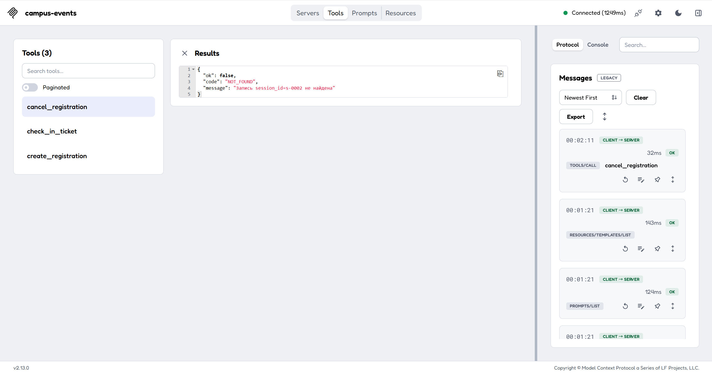

# Задание 5. MCP-сервер для AI-ассистента

MCP (Model Context Protocol) — способ отдать ассистенту не весь API, а три
вещи: **инструменты** (что он может сделать), **ресурсы** (что он может прочитать)
и **шаблоны промптов** (как вести типовой диалог). Сервер проекта — MVP на
MCP Python SDK 2.3.0: три инструмента, два ресурса и один шаблон, данные — в
mock-базе SQLite (`mcp/campus.db`), собранной из той же физической модели, что и
PostgreSQL-схема.

## 1. Инструменты

| Инструмент | Аргументы | Что делает | Возвращает | Ошибки |
|---|---|---|---|---|
| `create_registration` | `session_id` (string, обяз.), `user_id` (string, обяз.) | Записывает на сессию, проверяет свободные места и повторную запись | `registration_id`, `ticket_id`, `qr_payload`, `status`, `free_seats`, `participant` | `NOT_FOUND`, `NO_SEATS`, `ALREADY_REGISTERED`, `SESSION_IN_PAST` |
| `cancel_registration` | `registration_id` (string, обяз.), `reason` (string, необяз.) | Отменяет запись, освобождает место, гасит билет | `ok`, `registration_id`, `status`, `free_seats` | `NOT_FOUND`, `TICKET_USED` |
| `check_in_ticket` | `qr_payload` (string, обяз.) | Отмечает присутствие по строке из QR-кода, идемпотентно | `ok`, `ticket_id`, `participant`, `marked_at`, `already_marked` | `NOT_FOUND`, `TICKET_REVOKED` |

Схемы типизированы: у каждого аргумента есть тип и описание, обязательные поля
перечислены в `required`, поэтому ассистент не может вызвать инструмент «наугад».
Три инструмента — это ровно те действия, которые в API делают
`POST /sessions/{sid}/registrations`, `DELETE /registrations/{id}` и
`POST /tickets/{id}/check-in`.

## 2. Ресурсы

| URI | Содержимое | Зачем ассистенту |
|---|---|---|
| `catalog://events` | Опубликованные мероприятия с сессиями: `capacity`, `taken`, `free_seats` | Ответить «есть ли места» и выбрать сессию, не вызывая инструментов |
| `registrations://user/{user_id}` | Записи пользователя: статус, время, признак действующего билета | Ответить «на что я записан» и найти `registration_id` для отмены |

`free_seats` считается на стороне сервера: ассистенту не нужно вычитать `taken`
из `capacity`, а значит он не может ошибиться в арифметике. Ресурс
`registrations://user/{id}` отдаёт только ФИО, статус и время — персональные
данные сверх этого не раскрываются.

## 3. Шаблон промпта

`registration_help(event_title)` задаёт порядок «сначала данные, потом действие»:

1. прочитать `catalog://events` и найти мероприятие с его сессиями;
2. если свободных мест нет — не вызывать `create_registration`, а предложить лист ожидания;
3. иначе вызвать `create_registration(session_id, user_id)` и показать билет с QR-кодом.

Без такого шаблона модель склонна «сразу писать в базу». Шаблон переносит
проверку состояния в начало диалога.

## 4. Правила, которые держит сервер, а не модель

- **Места считает база.** `session.taken` меняется только триггером; инструмент
  не пишет `capacity` и не пересчитывает остаток сам.
- **Отменить использованный билет нельзя** — `cancel_registration` вернёт
  `TICKET_USED`, а не тихо испортит данные.
- **Повторная запись** на ту же сессию даёт `ALREADY_REGISTERED`, а не второй билет.
- **Отметка идемпотентна**: повторный `check_in_ticket` возвращает
  `already_marked: true` и не перезаписывает время.
- **Ошибки структурированы** (`code` + `message`), как в REST API: агент читает
  код и выбирает следующий шаг, а не разбирает прозу.

## 5. Проверка

Сервер проверен официальным **MCP Inspector** (2.13.0): подключение по stdio,
вкладка *Tools* показывает три инструмента, вызов возвращает структурированный
результат, справа виден журнал протокола (`resources/templates/list`,
`prompts/list`, `tools/call`).

Тот же сценарий прогнан в CLI-режиме Inspector (без браузера) и записан
пошагово: список инструментов и схем, успешная запись, двойная отметка билета,
обращение к несуществующей сессии — [протокол проверки](https://github.com/1997yyyy/Human-Machine-Interface-Design-LAB4/blob/main/mcp/inspector-cli.md).

Дополнительно `mcp/test_mcp.py` прогоняет 10 проверок без LLM-клиента:
успешная запись, отсутствие мест, повторная запись, отмена, отмена
использованного билета, отметка, повторная отметка, несуществующий билет,
чтение каталога, чтение записей пользователя.

## 6. Пример диалога

> **Пользователь:** «Запиши меня на хакатон, я Морозова, группа 4-2.»
>
> **Ассистент:** читает `catalog://events`, находит «Хакатон FPMI-2026», сессию
> `s-0002` (свободно 40 мест), вызывает
> `create_registration(session_id="s-0002", user_id="u-0006")`.
>
> **Инструмент:** `{"ok": true, "ticket_id": "t-0f81df63", "status": "Записан", "free_seats": 39, "participant": "Морозова Дарья Павловна"}`
>
> **Ассистент:** «Записала вас на 21 ноября, Главный корпус, коворкинг. Билет
> `t-0f81df63`, QR-код сохранён в приложении — он работает без сети.»

Исходный код и инструкция запуска — [mcp/README.md](https://github.com/1997yyyy/Human-Machine-Interface-Design-LAB4/blob/main/mcp/README.md),
сервер — `mcp/server.py`, mock-база собирается `mcp/make_mock_db.py`.
